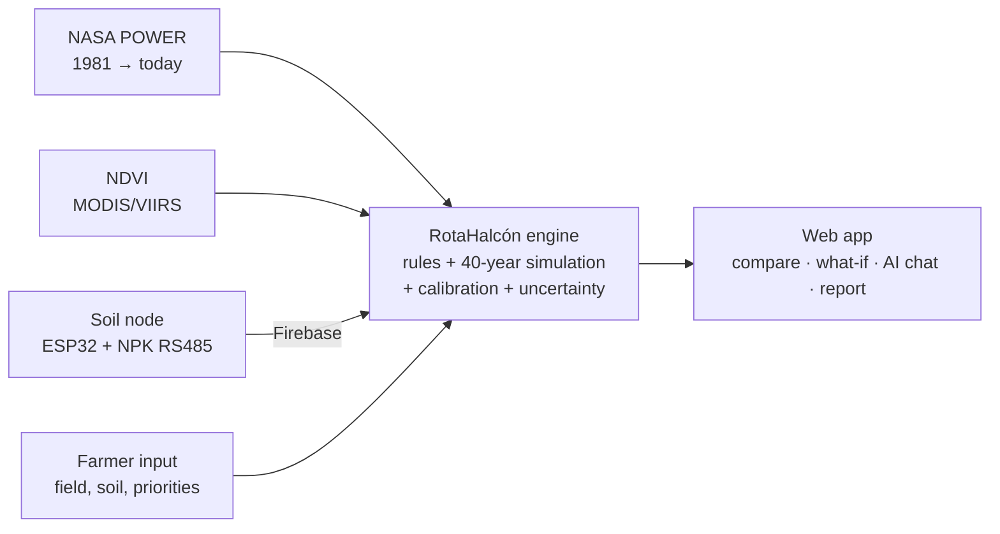

# 🦅 RotaHalcón — Crop rotation as climate insurance

> **Open-source decision-support tool** that tests crop rotations against **40+ years of real NASA climate data**, calibrates them with an **in-field soil sensor**, and explains — in plain language — **which rotation survives a bad year best.**

Built by **Halcones Dorados** (Mechatronics, ITSRLL — Durango, Mexico) for the **NASA Space Apps Challenge 2026** · Challenge: *Field Shift: Adapting Farms with NASA Data*.

🌎 **This project is open.** We want farmers, students, agronomists and developers anywhere to use it, adapt it to their region and improve it. See [How to contribute](#-how-to-contribute).

---

## 🌱 The problem
Small and medium farmers in Durango choose what to plant each season **without knowing how that choice would perform in a bad year**. A single dry or frosty year can cost the harvest, the water and the soil. Satellite data exists and is free — but it's hard to read, and it covers kilometers, not *your* field.

## 💡 The solution
1. **Mark your field** on a map and tell us your last 2 crops.
2. **The soil node reads your soil**: N, P, K, pH, salinity, moisture.
3. **RotaHalcón simulates** your current rotation + 3 alternatives over **every year since 1981** (NASA POWER).
4. **You get the answer**: traffic light, how many years each option fails, its worst year, the *why*, risks to check with an agronomist, a plan B, and a report you can send over WhatsApp.

**What makes it different**
- 📉 **The worst year, not the average** — "this rotation would have failed 3 of 42 years; yours, 9."
- 🛰️ **Satellite corrected by the ground** — NASA estimates are calibrated with a real sensor in the field.
- 🤖 **An AI that doesn't make things up** — every answer cites its source: NASA, SENSOR or FAO/INIFAP.

## ⚙️ How it works

Every value shown in the app is labeled **NASA** or **SENSOR**.

## 📡 Data sources
| Source | What we use it for |
|---|---|
| [NASA POWER](https://power.larc.nasa.gov/) | Daily rainfall, temperature, radiation, soil wetness since 1981 |
| NASA MODIS / VIIRS NDVI | Bare-soil months and vegetation vigor |
| Soil node (this repo, `hardware/`) | Ground truth: N, P, K, pH, EC, moisture of *this* field |
| FAO / INIFAP | Crop water needs, nitrogen fixation, frost tolerance — **every value cited in `data/`** |

## 🔧 Hardware
The field node is based on **AGRISENSE**, a soil-analysis device created at ITSRLL by Alberto Ortega, Gabriel Jahir Landa, Lizzeth Avalos, Cecilia Reyes and Angel Moreno, and shared with this project with their permission. 🙏 *Pre-existing hardware, declared as such.*

## 📁 Repository structure
| Folder | Contents |
|---|---|
| `hardware/` | Soil node firmware (ESP32 + NPK sensor over RS485/Modbus) |
| `backend/` | NASA data download, rule engine, 40-year simulation, API |
| `ia/` | Calibration models, uncertainty (bootstrap), grounded AI assistant |
| `web/` | Web app · `web/animacion/` "How it works" animation |
| `data/` | Crop table with sources, sample climate data |
| `docs/` | Pitch, slides, diagrams, AI-use declaration |

## 🚧 Status
Built during the NASA Space Apps Challenge, **Nov 14–15, 2026**. Case study: Durango, Mexico. Crops: bean, maize, oats, sorghum, alfalfa.

**Roadmap (open for contributions)**
- [ ] More crops and regions (NASA POWER is global)
- [ ] Climate projections (future scenarios)
- [ ] More sensors per community (shared ground truth)
- [ ] Spanish / English / indigenous-language interface
- [ ] Validation with farmers and agronomists

## 🤝 How to contribute
Ideas, data sources, translations, code and field validation are all welcome. Read **[CONTRIBUTING.md](CONTRIBUTING.md)** and open an issue.

## 🤖 AI use declaration
See [`docs/AI_USE.md`](docs/AI_USE.md).

## 👥 Team — Halcones Dorados
- Jassiel — Hardware & team lead
- [Name] — Data & backend
- [Name] — AI
- [Name] — Web, design & pitch

## 📄 License
Code: **MIT** ([LICENSE](LICENSE)) · Docs, images & animation: **CC BY 4.0**. Use it, adapt it, just credit the project.

> ⚠️ RotaHalcón is a **decision-support tool**. It does not replace the judgment of the farmer or an agronomist.
