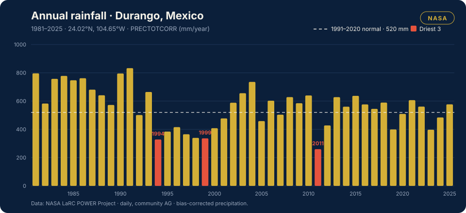

# Data

Owner: Role 2. Every dataset here states its **source** and carries a **NASA** or **SENSOR** label.

| Folder / file | Content | Source | Label |
|---|---|---|---|
| [`nasa_power/`](nasa_power/) | Daily climate 1981 → today for the example field (Durango) | NASA POWER | **NASA** |
| crop table *(next)* | Bean, maize, oats, sorghum, alfalfa: every value with its source | FAO / INIFAP | — |

---

## `nasa_power/` — Durango example field



**Location:** 24.02°N, 104.65°W · elevation 2,065 m · **Period:** 1981-01-01 → latest available day (45 complete years: 1981–2025).
**Request:** NASA POWER daily point API, community **AG**. The exact URL and download date are in `durango_metadata.json`.

| File | Rows | What it is |
|---|---|---|
| `durango_daily.csv` | 1 per day | Raw daily values, NASA parameter names as columns |
| `durango_monthly.csv` | 1 per month | Rain total, temperature means/min, frost days, soil wetness |
| `durango_annual.csv` | 1 per year | Same + `complete` flag + rain anomaly vs 1991–2020 normal |
| `durango_metadata.json` | — | Source, request URL, units, missing-value counts, notes, citation |
| `durango_annual_rain.svg` | — | Chart above (navy/gold project palette, ready for web & pitch) |

### Parameters (daily)
| Column | Unit | Meaning |
|---|---|---|
| `PRECTOTCORR` | mm/day | Precipitation, bias corrected |
| `T2M` / `T2M_MAX` / `T2M_MIN` | °C | Air temperature at 2 m: mean / max / min |
| `RH2M` | % | Relative humidity at 2 m |
| `ALLSKY_SFC_SW_DWN` | MJ/m²/day | Solar radiation at the surface — **only from 1984** |
| `GWETTOP` | 0–1 | Surface soil wetness (0–5 cm) |
| `GWETROOT` | 0–1 | Root-zone soil wetness (0–100 cm) |
| `GWETPROF` | 0–1 | Whole-profile soil wetness |

### Key facts (from this data)
- **Rain normal 1991–2020:** 519.5 mm/year.
- **Driest year:** **2011** — 259.9 mm, **−50 %** vs normal. Next: 1994 (−37 %), 1999 (−35 %), 1998 (−35 %).
- Rain and temperature have **no missing days**. Radiation is empty before 1984.

### ⚠️ Read before using
- **Soil wetness ≠ sensor moisture.** `GWET*` is a fraction of saturation (0–1), not volumetric moisture %. Convert it before comparing with the SENSOR reading (calibration, Role 3).
- **One pixel, not the plot.** POWER values come from a model grid cell (MERRA-2, ~50 km). They describe the region; the sensor describes the field.
- **Empty cell = missing value.** The API fill value `-999` is removed.
- `frost_days` = days with `T2M_MIN ≤ 0 °C`.
- The year count is **45**, not 42: the pitch and the UI should use the number from `durango_annual.csv`.

### Regenerate
```bash
python backend/nasa_power.py            # download again (needs internet)
python backend/nasa_power.py --offline  # rebuild summaries/chart from the saved CSV (Plan B)
```

### Citation
> These data were obtained from the NASA Langley Research Center (LaRC) POWER Project funded through the NASA Earth Science/Applied Science Program.
